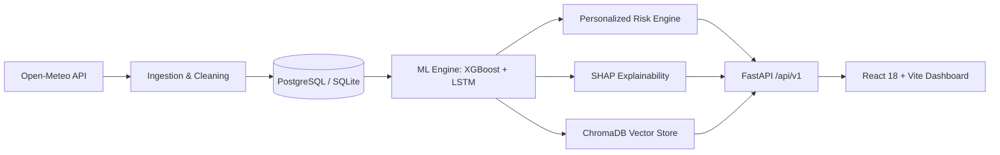

# WeatherGPT

**WeatherGPT** is a production-quality, explainable, uncertainty-aware weather intelligence platform. It turns raw meteorological telemetry into trustworthy, personalized outdoor and operational guidance.

## Architecture Highlights
- **Probabilistic Forecasting**: Quantile predictions (P10/P50/P90) with isotonic calibration.
- **Explainability**: SHAP (TreeExplainer) feature attributions for transparent atmospheric explanations.
- **Personalized Risk Scoring**: Contextual rule engine factoring activity profiles (running, commuting, travel, outdoor events) and widening caution when forecast uncertainty is high.
- **Grounded Conversational RAG**: Anti-hallucination assistant responding strictly from verified forecast context.
- **Real-Time Automated Ingestion**: Open-Meteo ingestion with physical bounds validation, imputation, and APScheduler background jobs.



## Quickstart

### 1. Run with Docker Compose
```bash
docker-compose up --build
```
- Dashboard: http://localhost:3000
- Backend Swagger API Docs: http://localhost:8000/docs
- Health endpoint: http://localhost:8000/api/v1/health

### 2. Local Development

#### Backend
```bash
cd backend
python -m venv .venv
# On Windows: .venv\Scripts\activate
# On Linux/macOS: source .venv/bin/activate
pip install -r requirements.txt
uvicorn app.main:app --reload --port 8000
```

Run tests:
```bash
cd backend
pytest -v
```

#### Frontend
```bash
cd frontend
npm install
npm run dev
```

Run frontend tests:
```bash
cd frontend
npm run test
```

## Project Structure
```
weathergpt/
├── backend/
│   ├── app/
│   │   ├── main.py, config.py, deps.py
│   │   ├── api/          # forecast, alerts, chat, settings, admin, health
│   │   ├── core/         # logging, errors, security
│   │   ├── db/           # models, session
│   │   ├── ingestion/    # open_meteo, noaa, cleaning, scheduler
│   │   ├── ml/           # features, models, uncertainty, explain
│   │   ├── risk/         # rule-based risk engine
│   │   ├── rag/          # embeddings, store, retriever, guardrails
│   │   └── schemas/      # Pydantic v2 schemas
│   ├── tests/
│   ├── pyproject.toml / requirements.txt
│   └── Dockerfile
├── frontend/
│   ├── src/              # api, components, pages, hooks, lib, types
│   ├── tailwind.config.ts, vite.config.ts, Dockerfile
├── docker-compose.yml
├── .env.example
├── docs/                 # architecture.md, api.md, evaluation.md
└── README.md
```
