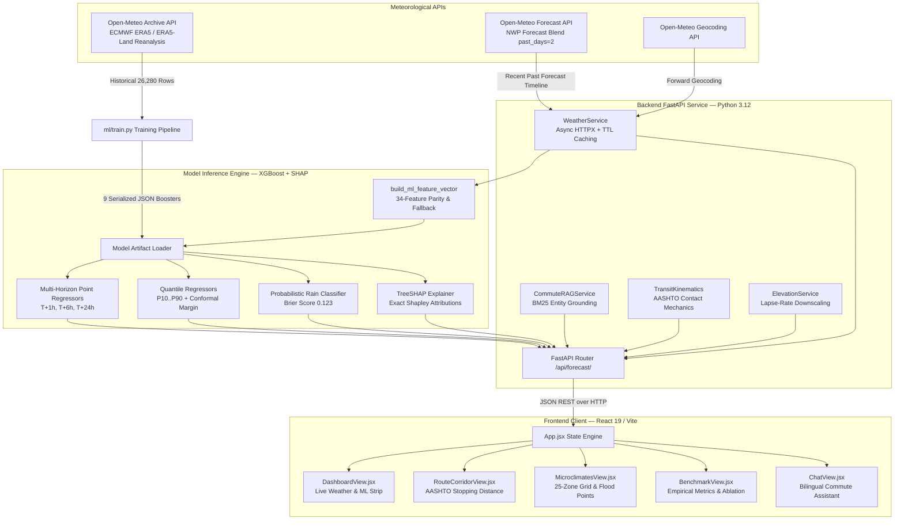
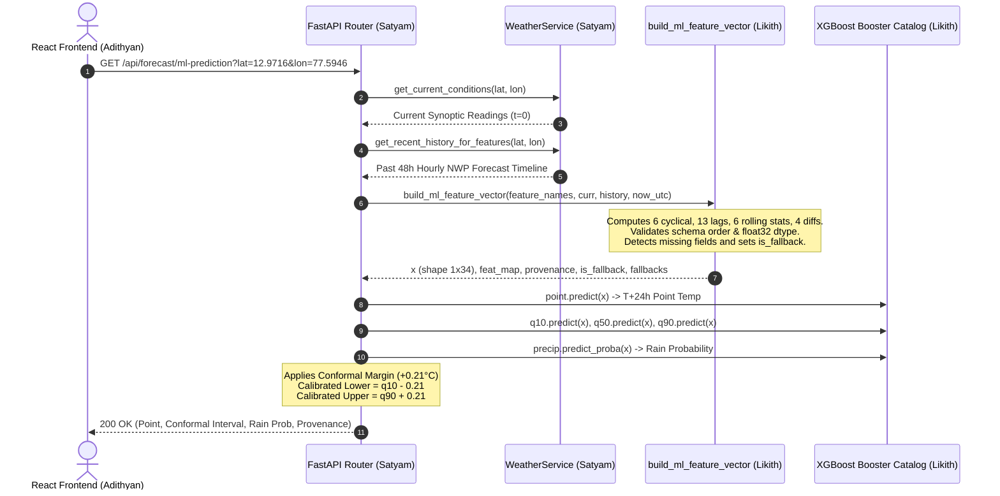
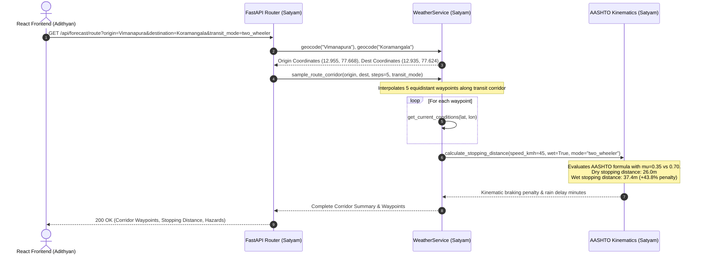

# WeatherGPT Bharat: Technical Architecture & Team Division of Work Specification

> **CROSS-DOCUMENT DESIGNATION & CANONICAL POINTER**:  
> This document serves as the formal **Team Division of Work, Architectural Modularization, and Component Responsibility Specification** for the MSc AI & ML Capstone project (*System Project Development — SPD*).  
> For the comprehensive scientific derivations, data leakage audits, mathematical proofs (leak-free Brier score, finite-sample conformal index), and exhaustive benchmark tables, refer directly to the canonical technical report: [`WeatherGPT_Final_Technical_Report.md`](WeatherGPT_Final_Technical_Report.md).

---

## 1. Project Identification & Capstone Team Overview

* **Project Title**: WeatherGPT Bharat — Location-Aware Meteorological Intelligence & Commute Risk Platform
* **Academic Program**: Master of Science in Artificial Intelligence & Machine Learning (Final Year Capstone / SPD)
* **Target Urban Testbed**: Bengaluru Metropolitan Region (`12.9716°N, 77.5946°E`, Deccan Plateau, ~915m ASL)
* **Team Members & Core Project Roles**:
  1. **Satyam** — Lead System Architect, Backend Services, Spatial Routing Physics & Grounded Commute RAG
  2. **Likith** — Senior Machine Learning Engineer, Multi-Horizon Forecasting, Uncertainty Quantification & TreeSHAP
  3. **Adithyan** — Frontend Architect, Geospatial UI/UX, Component Visualization & Responsive Systems Design

---

## 2. High-Level Architectural Decomposition

The system is engineered as an asynchronous, decoupled, microservice-inspired architecture designed to bridge historical atmospheric reanalysis, recent numerical weather predictions, and real-time transit kinematics.

---

## 3. Team Member Division of Work & Code Ownership

To ensure accountability and academic rigor, each team member took primary ownership of specific subsystems, verified through test cases, documentation, and source code commits.

### 3.1 Member 1: Satyam — Lead Backend & Systems Architect

* **Role**: Lead Architect, Backend Systems, Spatial Routing & Grounded RAG
* **Primary Code Ownership**:
  - `backend/app/main.py`: FastAPI application lifecycle, CORS middleware, global exception handlers, and API router mounting.
  - `backend/app/api/forecast.py`: Implementation of route corridor analysis (`/api/forecast/route`), air quality telemetry (`/api/forecast/aqi`), Bengaluru microclimate matrix (`/api/forecast/bangalore/microclimates`), and geocoding services.
  - `backend/app/services/weather.py`:
    - Async HTTPX client integration with resilient in-memory TTL caching (5-min current weather, 15-min hourly forecast, 1-hour air quality).
    - API quota tracking and latency instrumentation (`get_quota_telemetry`).
    - Contact mechanics implementation: Analytical stopping distance calculation using AASHTO highway design equations:
      $$d_{\text{stop}} = v \cdot t_{\text{reaction}} + \frac{v^2}{2 g (\mu \pm G)}$$
      Modeling tire-pavement friction reduction from dry asphalt ($\mu = 0.70$) to wet asphalt ($\mu = 0.35$), yielding a +43.8% stopping distance penalty for two-wheelers ($26.0\text{m} \to 37.4\text{m}$ at $45\text{ km/h}$ with $t_{\text{alert}} = 1.17\text{s}$).
    - Topographic downscaling: Standard atmospheric lapse-rate adjustment ($\Gamma = 6.5^\circ\text{C}/\text{km}$) across 25 Bengaluru localities relative to central CBD elevation (915m ASL).
    - Contextual flood chokepoints registry integrating CAG Report No. 2 of 2021 and KSNDMC flood vulnerability mappings.
  - `backend/app/services/rag_service.py`: Commute RAG entity resolution with BM25 token matching, linking commuter origin-destination queries to flood chokepoints and route recommendations.
  - `backend/tests/test_api.py`: Automated test authoring covering routing, geocoding, air quality, contact mechanics, and microclimates.

### 3.2 Member 2: Likith — Senior Machine Learning Engineer

* **Role**: Machine Learning Engineer, Uncertainty Quantification & Explainability
* **Primary Code Ownership**:
  - `ml/fetch_data.py`:
    - Automated ingestion of 26,280 hourly observations (2021–2023) from Open-Meteo Historical Archive (ECMWF ERA5 & ERA5-Land reanalysis).
    - Handling API pagination, rate-limiting backoffs, and saving to `data/bengaluru_hourly_2021_2023.csv`.
  - `ml/train.py`:
    - Chronological walk-forward cross-validation pipeline with strict **24-hour purge/embargo gap** to eliminate target forward overlap leakage ($26,208 \to 26,160$ assigned rows: 18,321 train, 3,907 val, 3,932 test).
    - Feature engineering engine generating the exact 34-feature schema (5 raw, 6 cyclical, 13 lags, 6 rolling statistics, 4 differences).
    - Multi-horizon gradient-boosted regression training ($T+1\text{h}$, $T+6\text{h}$, $T+24\text{h}$) with XGBoost 3.2.0.
    - Quantile regression models for $\tau \in \{0.10, 0.25, 0.50, 0.75, 0.90\}$ using Pinball Loss.
    - Split Conformal Prediction calibration: Computing non-conformity scores on validation data with finite-sample quantile index ($k = \lceil 3908 \times 0.80 \rceil = 3127$) to derive calibrated margin $\Delta = +0.21^\circ\text{C}$ (yielding 82.1% empirical test coverage).
    - Dedicated probabilistic precipitation classifier ($T+24\text{h}$) with leakage-free baseline audit (Brier score 0.123, ROC-AUC 0.837).
    - Multi-horizon feature ablation study across 4 distinct representation layers.
    - TreeSHAP explainer initialization (`shap.TreeExplainer`) with 100-sample background distribution export.
    - Serialization of 9 native JSON boosters to `ml/artifacts/`.
  - `backend/app/api/forecast.py` (ML Integration):
    - Implementation of `/api/forecast/ml-prediction` and `/api/forecast/explain`.
    - Implementation of `build_ml_feature_vector()`: Constructing the ordered 34-feature vector, checking schema dimensionality `(1, 34)` and `float32` dtype, and tracking fallback imputations (`is_fallback`, `fallback_imputations`, `feature_provenance`).
  - `backend/tests/test_api.py` (ML Suite):
    - Tests for temporal purge gap, Brier mathematical proof, finite conformal index, artifact completeness, and strict feature parity ordering.

### 3.3 Member 3: Adithyan — Frontend Architect & Systems Design

* **Role**: Frontend Architect, Spatial UX, Visual Analytics & Systems Design
* **Primary Code Ownership**:
  - `frontend/src/App.jsx`: Root application coordinator, active view routing, unified location state management, and real-time temperature/speed unit conversion toggles (°C/°F, km/h / mph).
  - `frontend/src/services/api.js`: Unified Axios HTTP client with centralized error formatting and fallback mock handling.
  - `frontend/src/components/DashboardView.jsx`:
    - Real-time weather overview with animated synoptic cards.
    - Dedicated **WeatherGPT Custom ML Inference Card** displaying $T+24\text{h}$ point prediction, calibrated Split Conformal interval $[P_{10} - \Delta, P_{90} + \Delta]$, rain risk probability, and explicit feature provenance tags (`Recent Past NWP Forecast` vs `Synoptic Timeline Fallback`).
    - Interactive TreeSHAP feature attribution inspector with expandable top physical drivers.
  - `frontend/src/components/RouteCorridorView.jsx`:
    - Multi-waypoint transit corridor planner with origin-destination geocoding search.
    - Interactive Leaflet map visualizing sampled route corridor waypoints.
    - Multi-modal vehicle physics selector (Two-Wheeler, Auto/Cab, Four-Wheeler, Pedestrian) with dynamic wet asphalt stopping distance penalties and rain delay estimates.
  - `frontend/src/components/MicroclimatesView.jsx`:
    - 25-zone interactive Bengaluru neighborhood matrix with search and sorting.
    - Elevation hypsometry indicators, downscaled microclimate temperatures, and regional rain odds.
    - High-visibility **Contextual Historical Inundation Susceptibility Chokepoint** warning badges (Sony World, Ejipura underpass, Silk Board, Bellandur ORR) referencing CAG 2021 audit data.
  - `frontend/src/components/BenchmarkView.jsx`:
    - Member 1/2 capstone deliverable visualizer rendering live metrics from `/api/forecast/benchmarks`.
    - Multi-horizon model comparison cards ($T+1\text{h}$, $T+6\text{h}$, $T+24\text{h}$).
    - 4-layer stacked feature ablation visualizer.
    - Quantile reliability curve and precipitation Brier score benchmark cards.
  - `frontend/src/components/ChatView.jsx`: Bilingual interactive commute assistant with Kannada (ಕನ್ನಡ) and Hindi (हिंदी) regional accessibility badges.
  - `frontend/src/App.css`: Complete modern glassmorphism design system in Vanilla CSS, custom scrollbars, responsive layouts, and elimination of horizontal overflow issues.

---

## 4. Component Interaction & Inter-Service API Specifications

### 4.1 Live ML Inference Pipeline (`/api/forecast/ml-prediction`)

### 4.2 Route Corridor Transit Physics Pipeline (`/api/forecast/route`)

---

## 5. Software Quality Assurance & Test Ownership Matrix

The test suite in [`backend/tests/test_api.py`](backend/tests/test_api.py) contains **31 passing automated regression tests** executed in **24.64s** (`pytest -v`), partitioned across team member domains:

| Test Identifier | Category | Code Owner | Verifies |
| :--- | :--- | :---: | :--- |
| `test_health_check`, `test_root_endpoint` | System Health | Satyam | FastAPI lifecycle and documentation routing |
| `test_geocode_search` | Spatial Service | Satyam | Open-Meteo geocoding search and coordinate resolution |
| `test_current_weather`, `test_hourly_forecast`, `test_daily_forecast` | Weather Telemetry | Satyam | Synoptic ingestion, time-series arrays, and caching |
| `test_invalid_coordinates` | Validation | Satyam | Pydantic latitude/longitude coordinate bounds validation |
| `test_route_corridor`, `test_route_corridor_with_transit_mode` | Transit Physics | Satyam | Corridor waypoint interpolation and vehicle transit modes |
| `test_contact_mechanics_stopping_distance` | Kinematics | Satyam | AASHTO braking distance: dry 26.0m $\to$ wet 37.4m (+43.8%) |
| `test_lapse_rate_elevation_hypsometry` | Topography | Satyam | Hydrostatic elevation lapse rate $\Gamma = 6.5^\circ\text{C}/\text{km}$ |
| `test_bangalore_microclimates`, `test_microclimates_scientific_provenance` | Microclimates | Satyam | 25-zone registry and static CAG 2021 flood chokepoints |
| `test_air_quality_telemetry` | Atmospheric Health | Satyam | AQI, PM2.5, PM10 ingestion and commuter advisories |
| `test_chat_grounded_response`, `test_commute_rag_entity_resolution` | Grounded RAG | Satyam | BM25 entity grounding and commute advice without hallucinations |
| `test_admin_metrics`, `test_weather_service_resilience_and_fallbacks` | Observability | Satyam | API quota tracking, error resilience, and graceful fallbacks |
| `test_ml_prediction_endpoint` | ML Integration | Likith | Live XGBoost prediction, quantiles, and conformal interval |
| `test_forecast_explain`, `test_genuine_treeshap_attributions` | Explainability | Likith | Genuine TreeSHAP feature attributions and base values |
| `test_model_benchmarks`, `test_reproducible_ml_benchmarks` | ML Benchmarking | Likith | Programmatic loading of `benchmark_results.json` |
| `test_temporal_purge_gap_zero_target_leakage` | Methodology | Likith | 24-hour forward purge gaps and 26,160 assigned rows |
| `test_precipitation_baseline_training_only_leak_free` | Methodology | Likith | Mathematical verification of leak-free 0.158 Brier score |
| `test_split_conformal_calibration_finite_sample_index` | UQ Calibration | Likith | Finite index $k=3127$ and 82.1% empirical test coverage |
| `test_model_artifact_manifest_completeness` | Deployment | Likith | All 9 trained XGBoost models present and loadable |
| `test_feature_schema_and_provenance_audit` | Feature Parity | Likith | Strict 34-feature schema, ordering, and domain shift notice |
| `test_feature_parity_strict_ordering_and_vector_shape` | Feature Parity | Likith | Schema order, dimension `(1, 34)`, `float32`, and omission error |
| `test_live_variable_absence_triggers_explicit_fallback_tracking` | Resilience | Likith | Fallback tracking (`is_fallback=True`, `fallback_imputations`) |

---

## 6. Viva Voce Defense Guide by Role

When presenting WeatherGPT Bharat before the MSc capstone examination committee, each team member should emphasize their domain-specific technical contributions and honest scientific qualifications:

### For Satyam (Lead Systems Architect & Backend Developer):
* **Commute Physics vs Radar Claims**: Defend the route corridor model as an **analytical kinematic formulation** using standard AASHTO civil highway equations, explicitly acknowledging that friction coefficients ($\mu=0.70 \to 0.35$) are theoretical vehicle contact mechanics, not empirical crash statistics.
* **Topographic Lapse Rates**: Defend the 25-zone microclimate matrix as a **hypsometric elevation adjustment**, making clear that hydrostatic temperature lapse rates downscale ambient temperatures but do not validate local microclimates without physical ground telemetry networks.
* **Drainage Overlays**: Clarify that waterlogging chokepoints are **contextual historical vulnerability tags** sourced from CAG Report No. 2 of 2021 and KSNDMC flood maps, not dynamic 2D hydrodynamic flood simulations.

### For Likith (Senior Machine Learning Engineer):
* **Diurnal Persistence Barrier**: Address the $T+24\text{h}$ benchmark openly: explain why simple 24-hour persistence (0.75°C MAE) is an extraordinarily strong trivial baseline in tropical plateau climates, and pivot to the massive ML gains at non-periodic horizons (+56.3% at $T+1\text{h}$, +80.2% at $T+6\text{h}$).
* **Precipitation Baseline Leakage Proof**: Walk through the arithmetic proof demonstrating that training base rate ($0.21505$) scored on test labels yields $0.15814 \approx 0.158$, proving that the baseline is leak-free and that the apparent test variance match is a rounding coincidence.
* **Exchangeability in Time Series**: Discuss Split Conformal Prediction honestly: explain that while conformal prediction guarantees marginal coverage under exchangeability, weather data has temporal autocorrelation; hence, our 82.1% coverage is an **empirically validated measurement on held-out test data**, not an unconditional distribution-free guarantee.
* **Live Feature Parity & Domain Shift**: Demonstrate `build_ml_feature_vector()`: show how all 34 features are ordered with `float32` dtypes and how missing variables trigger explicit `is_fallback=True` tags, transparently documenting the domain shift between ERA5 reanalysis training data and recent NWP forecast inference lags.

### For Adithyan (Frontend Architect & Spatial UX):
* **Clarity of Scientific Status**: Emphasize how the React UI communicates probabilistic uncertainty: displaying calibrated conformal intervals rather than misleading single-temperature numbers, and color-coding feature provenance tags (`Recent Past NWP Forecast` in green vs `Synoptic Timeline Fallback` in amber).
* **Responsive Commuter Ergonomics**: Highlight mobile-first responsiveness, zero horizontal scroll overflow, bilingual regional badges (Kannada & Hindi), and intuitive TreeSHAP feature attribution inspection for everyday commuters.
