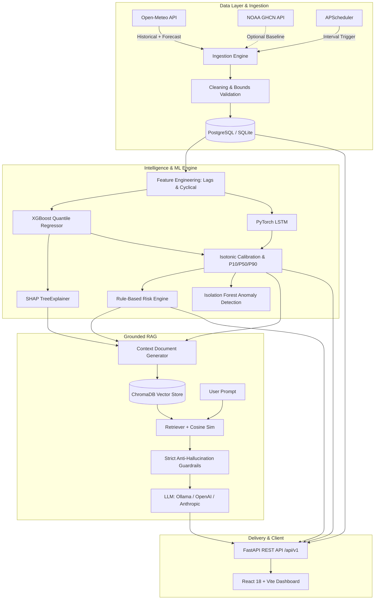

# WeatherGPT Architecture & System Design

## Core Subsystems

### 1. Ingestion & Preprocessing
- **Source**: Open-Meteo high-resolution hourly forecast and archive endpoints.
- **Physical Bounds Validation**: Strict filtering on temperature (-90°C to 60°C), pressure (870 to 1085 hPa), wind speed (0 to 350 km/h), and precipitation (0 to 300 mm/h).
- **Interpolation**: Linear interpolation for missing sensory telemetry with imputation audit flags.

### 2. Probabilistic ML Forecasting
- Calibrated quantiles (P10, P50, P90) giving actionable uncertainty margins.
- Dual-head forecasting for continuous temperature and precipitation probabilities.

### 3. Risk Engine & Personalized Decisions
- Computes activity-specific hazard indices (commuting, running, outdoor events, travel).
- Escalates caution when forecast uncertainty bands widen.

### 4. RAG Chatbot
- Grounded solely on ingested and predicted telemetry.
- Zero-tolerance anti-hallucination guardrails: if missing or low-confidence, answers "I'm not sure".
